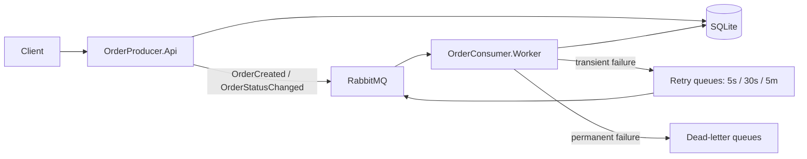

# Order Messaging System

A practical demo of asynchronous messaging with ASP.NET Core, a background worker, RabbitMQ, and SQLite.

## 1. Project Overview

OrderMessagingSystem accepts orders through a small HTTP API, saves them in SQLite, and publishes an `OrderCreated` message to RabbitMQ. A separate background worker consumes the message, simulates order processing, and updates the order status in the shared database. RabbitMQ is the message broker: it holds messages while the worker is offline and delivers them when the worker reconnects. The API and worker run as independent processes, but they use the same SQLite file and the same RabbitMQ queues. Status updates use a second queue, and failures are handled with retry queues and dead-letter queues (DLQs).

**Projects in the solution:**

| Folder | Purpose |
| --- | --- |
| `OrderProducer.Api` | Minimal API: create and query orders, publish events |
| `OrderConsumer.Worker` | Background worker: consume orders and status updates, retry failures, update SQLite |
| `OrderPersistence` | EF Core and SQLite storage, including the message deduplication table |
| `Shared.Contracts` | Event records, RabbitMQ settings, queue topology, retry helpers |
| `OrderMessagingSystem.Tests` | Unit tests and optional RabbitMQ integration tests |



## 2. Prerequisites

Install these tools before you start:

| Tool | Why you need it | Official link |
| --- | --- | --- |
| .NET 10 SDK | Build and run the API, worker, and tests | https://dotnet.microsoft.com/download/dotnet/10.0 |
| Docker Engine or Docker Desktop | Run RabbitMQ in a container | https://docs.docker.com/engine/install/ or https://www.docker.com/products/docker-desktop/ |
| Docker Compose v2 | Start RabbitMQ with one command | Included with Docker Desktop and current Docker Engine |
| Git | Clone the repository | https://git-scm.com/downloads |
| VS Code (optional) | Edit and debug the code | https://code.visualstudio.com/ |
| Postman (optional) | Send HTTP requests with a graphical UI | https://www.postman.com/downloads/ |

Check the installed versions:

```bash
dotnet --version
docker --version
docker compose version
git --version
```

`dotnet --version` must print a **10.x** version. If it prints a lower version, install the .NET 10 SDK.

**Supported operating systems:** Windows 10/11, macOS, and Linux. RabbitMQ runs in a Linux container, so Docker Desktop (Windows/macOS) or Docker Engine (Linux) is required. The commands below use bash/zsh syntax. On Windows, use WSL, Git Bash, or adapt the environment variables to PowerShell.

## 3. Clone the Repository

Open a terminal in the folder where you keep your projects, then run:

```bash
git clone https://github.com/Sopanhaa/message.broker.git
cd message.broker
```

The repository root is the folder that contains `OrderMessagingSystem.slnx`. Run every command in this README from that folder unless a step says otherwise.

Quick check:

```bash
ls
```

You should see `OrderMessagingSystem.slnx`, `docker-compose.yml`, `README.md`, and the project folders.

## 4. Configure the Project

The default configuration works on a local computer. You do not need to edit any file for the first run.

### RabbitMQ settings

Both `OrderProducer.Api/appsettings.json` and `OrderConsumer.Worker/appsettings.json` contain the same section:

```json
"RabbitMq": {
  "HostName": "localhost",
  "Port": 5673,
  "UserName": "orderdev",
  "Password": "orderdev_password",
  "VirtualHost": "/",
  "QueueName": "orders",
  "PublishTimeoutSeconds": 10
}
```

- **Port `5673`** is the host port mapped to RabbitMQ's AMQP port `5672` inside Docker.
- **`orderdev` / `orderdev_password`** are development-only credentials. Do not reuse them on a public server.
- **`QueueName`** is the base name. The app also uses `orders.status`, the retry queues, and two dead-letter queues.
- **Both files must match.** If the API and worker use different credentials, ports, or queue names, they cannot communicate.

### Docker Compose settings

`docker-compose.yml` creates the RabbitMQ user from these variables:

```yaml
RABBITMQ_DEFAULT_USER: ${RABBITMQ_USER:-orderdev}
RABBITMQ_DEFAULT_PASS: ${RABBITMQ_PASSWORD:-orderdev_password}
```

If you change `RABBITMQ_USER` or `RABBITMQ_PASSWORD`, also change `RabbitMq:UserName` and `RabbitMq:Password` in **both** `appsettings.json` files. RabbitMQ applies these variables only when its data volume is first initialized.

### SQLite database

Both apps use one shared SQLite file:

| Operating system | Default path |
| --- | --- |
| Linux | `~/.local/share/OrderMessagingSystem/orders.db` |
| macOS | `~/Library/Application Support/OrderMessagingSystem/orders.db` |
| Windows | `%LOCALAPPDATA%\OrderMessagingSystem\orders.db` |

The folder and schema are created automatically on startup. The API and worker must point to the **same file**.

To use a different location, set `Database__Path` in both terminals:

```bash
# Terminal 2 (API)
Database__Path=/tmp/orders.db dotnet run --project OrderProducer.Api

# Terminal 3 (Worker)
Database__Path=/tmp/orders.db dotnet run --project OrderConsumer.Worker
```

A relative path is resolved under the default `OrderMessagingSystem` folder. If you set this variable for only one process, the two apps will use different databases and the worker will not find the API's orders.

### Environment variables

You can override configuration without editing JSON:

| Variable | Example |
| --- | --- |
| `RabbitMq__HostName` | `localhost` |
| `RabbitMq__Port` | `5673` |
| `RabbitMq__UserName` | `orderdev` |
| `RabbitMq__Password` | `orderdev_password` |
| `RabbitMq__VirtualHost` | `/` |
| `RabbitMq__QueueName` | `orders` |
| `RabbitMq__PublishTimeoutSeconds` | `10` |
| `Database__Path` | `/tmp/orders.db` |

Use a double underscore (`__`) to separate nested keys. On PowerShell, set a variable with `$env:Database__Path="C:\temp\orders.db"`.

> `GET /health` is a liveness check only. It returns `200` even when RabbitMQ is down. Use `docker compose ps` to check RabbitMQ.

## 5. Start RabbitMQ with Docker

Make sure Docker is running, then run this from the repository root:

```bash
docker compose up -d --wait
```

`--wait` returns when the container health check passes. You should see output ending with **Healthy**.

Verify:

```bash
docker compose ps
```

The `rabbitmq` service should show `Up ... (healthy)` and these ports:

- `127.0.0.1:5673->5672/tcp` — AMQP
- `127.0.0.1:15673->15672/tcp` — Management UI

If the container is not healthy yet, wait a few seconds and run `docker compose ps` again. You can also watch the logs:

```bash
docker compose logs -f rabbitmq
```

Press `Ctrl+C` to stop watching the logs. This does not stop RabbitMQ.

### RabbitMQ Management UI

Open **http://localhost:15673** in your browser.

Use the development login:

| Username | Password |
| --- | --- |
| `orderdev` | `orderdev_password` |

These values come from `docker-compose.yml`, or from your `RABBITMQ_USER` / `RABBITMQ_PASSWORD` environment variables. If the login fails, see Section 13.

The Management UI is bound to `127.0.0.1`, so it is reachable only from your computer.

## 6. Restore and Build

From the repository root:

```bash
dotnet restore
dotnet build
```

Both commands find `OrderMessagingSystem.slnx` automatically. If your terminal does not find it, run:

```bash
dotnet restore OrderMessagingSystem.slnx
dotnet build OrderMessagingSystem.slnx
```

A successful build ends with:

```text
Build succeeded.
    0 Warning(s)
    0 Error(s)
```

### If the SDK is missing

If you see `dotnet: command not found`, install the .NET 10 SDK from https://dotnet.microsoft.com/download/dotnet/10.0 and open a new terminal.

If you see `NETSDK1045`, the installed SDK is too old. Check the installed SDKs:

```bash
dotnet --list-sdks
```

Install a **10.x** SDK and try again.

## 7. Run the API

Open a terminal in the repository root. This is **Terminal 2** if you started RabbitMQ in Terminal 1.

```bash
dotnet run --project OrderProducer.Api
```

Wait for:

```text
Now listening on: http://localhost:5000
Application started. Press Ctrl+C to shut down.
```

The API listens on **http://localhost:5000** (configured in `OrderProducer.Api/Properties/launchSettings.json`). It creates the SQLite database on startup.

Quick check in another terminal:

```bash
curl http://localhost:5000/health
```

Expected:

```json
{"status":"healthy","check":"liveness"}
```

Leave this terminal running. Stop the API with `Ctrl+C`.

> The API connects to RabbitMQ lazily, on the first publish. It can start while RabbitMQ is down, but `POST /orders` will return `503`.

## 8. Run the Worker

Open another terminal (**Terminal 3**) in the repository root. The API must keep running.

```bash
dotnet run --project OrderConsumer.Worker
```

Wait for:

```text
Waiting for orders in orders and status updates in orders.status; prefetch=1 per queue, manual acknowledgments enabled
```

This means the worker connected to RabbitMQ, declared the main queues, retry queues, and dead-letter exchanges, and is waiting for messages.

If RabbitMQ is not ready, the worker logs `Consumer connection failed` and retries every 5 seconds. Start RabbitMQ and watch it recover.

Leave this terminal running. Stop the worker with `Ctrl+C`.

## 9. Test the Project Step by Step

### Step 1 — Check RabbitMQ

```bash
docker compose ps
```

The `rabbitmq` service must be `healthy`.

### Step 2 — Start the API

In **Terminal 2**:

```bash
dotnet run --project OrderProducer.Api
```

Wait for `Now listening on: http://localhost:5000`.

### Step 3 — Start the Worker

In **Terminal 3**:

```bash
dotnet run --project OrderConsumer.Worker
```

Wait for `Waiting for orders in orders and status updates in orders.status`.

### Step 4 — Open a request terminal

Use **Postman** or open **Terminal 4**. The examples below use `curl`.

> On Windows PowerShell, `curl` is an alias for `Invoke-WebRequest`. Use `curl.exe` or Postman instead.

### Step 5 — Send an order

```bash
curl -i -X POST http://localhost:5000/orders \
  -H 'Content-Type: application/json' \
  -d '{"customerName":"Sopanha","totalAmount":50.00,"products":[{"name":"Keyboard","quantity":2,"unitPrice":20.00},{"name":"Mouse","quantity":1,"unitPrice":10.00}]}'
```

If you use Postman:

- Method: `POST`
- URL: `http://localhost:5000/orders`
- Header: `Content-Type: application/json`
- Body → raw → JSON: the JSON shown above.

### Step 6 — Check the API response

A successful request returns `HTTP/1.1 202 Accepted` and a body like this:

```json
{
  "orderId": "1c560764-7af9-4af8-843a-107e0e899dc2",
  "status": "accepted",
  "createdAtUtc": "2026-11-10T07:31:21.5687367+00:00"
}
```

**This is example output.** Your `orderId` and `createdAtUtc` will be different. Copy the `orderId`; you will need it in Step 9.

If you get `400 Bad Request`, check that `totalAmount` equals the sum of `quantity * unitPrice` for all products. If you get `503 Service Unavailable`, RabbitMQ is not reachable.

### Step 7 — Watch the worker

Switch to **Terminal 3**. Within a second or two you should see:

```text
Processing order <your-order-id>: customer=Sopanha, total=50.00
Order product: name=Keyboard, quantity=2, unitPrice=20.00
Order product: name=Mouse, quantity=1, unitPrice=10.00
Completed order <your-order-id>
Processed and acknowledged order <your-order-id>
```

**This is example output.** The order ID and timestamps will differ. You may also see EF Core SQL command logs; they are normal.

### Step 8 — Check RabbitMQ

1. Open **http://localhost:15673**.
2. Sign in with `orderdev` / `orderdev_password`.
3. Select **Queues and Streams**.

You should see:

| Queue | What it is |
| --- | --- |
| `orders` | New orders waiting to be processed |
| `orders.status` | Status updates waiting to be applied |
| `orders.retry.5s`, `orders.retry.30s`, `orders.retry.5m` | Delayed order retries |
| `orders.status.retry.5s`, `orders.status.retry.30s`, `orders.status.retry.5m` | Delayed status retries |
| `orders.dead-letter` | Orders that failed permanently |
| `orders.status.dead-letter` | Status updates that failed permanently |

An empty `orders` queue is normal: the worker may have already processed the message. Retry queues have no consumers and drain themselves when their TTL expires.

### Step 9 — Check the saved order

Use the `orderId` from Step 6:

```bash
curl -i http://localhost:5000/orders/PASTE_ORDER_ID_HERE
```

Expected structure:

```json
{
  "orderId": "1c560764-7af9-4af8-843a-107e0e899dc2",
  "customerName": "Sopanha",
  "totalAmount": 50.0,
  "createdAtUtc": "2026-11-10T07:31:21.5687367+00:00",
  "products": [
    { "name": "Keyboard", "quantity": 2, "unitPrice": 20.00 },
    { "name": "Mouse", "quantity": 1, "unitPrice": 10.00 }
  ],
  "status": "Completed",
  "statusDetail": null,
  "statusUpdatedAtUtc": "2026-11-10T07:31:23.4708658+00:00"
}
```

**This is example output.** Right after creation, the status may still be `Received` or `Processing`. Wait one or two seconds and request it again; it should become `Completed`.

#### Optional: update the status

```bash
curl -i -X PATCH http://localhost:5000/orders/PASTE_ORDER_ID_HERE/status \
  -H 'Content-Type: application/json' \
  -d '{"status":"Failed","detail":"Manual review"}'
```

The API returns `202 Accepted`. After the worker applies the update, `GET /orders/{id}` shows `"status": "Failed"` and `"statusDetail": "Manual review"`.

Accepted status values are `Received`, `Processing`, `Completed`, and `Failed`. `detail` is optional and limited to 500 characters.

#### Optional: query SQLite directly

The `sqlite3` command is not required to use the project:

```bash
sqlite3 ~/.local/share/OrderMessagingSystem/orders.db \
  "SELECT OrderId, Status, StatusDetail FROM Orders ORDER BY CreatedAtUtc DESC LIMIT 5;"
```

On macOS, replace the path with `~/Library/Application Support/OrderMessagingSystem/orders.db`. On Windows, replace it with `%LOCALAPPDATA%\OrderMessagingSystem\orders.db`. If you set `Database__Path`, use that file instead.

## 10. Test Retry and DLQ

The worker retries **transient** failures and keeps permanent failures in the dead-letter queue (DLQ). The worker writes its logs to the terminal where you started it, so check that terminal first when a message is not processed.

### What is retried

| Failure | Action |
| --- | --- |
| Invalid JSON or invalid order data | Sent directly to the DLQ; retrying cannot fix the payload |
| `IOException`, `TimeoutException`, SQLite busy/locked errors (including wrapped errors) | Retried on a 5s → 30s → 5m schedule, then sent to the DLQ |
| Any other unexpected exception | Sent to the DLQ |

The retry queues are:

| Attempt | Order queue | Status queue | Delay |
| --- | --- | --- | --- |
| 1 | `orders.retry.5s` | `orders.status.retry.5s` | 5 seconds |
| 2 | `orders.retry.30s` | `orders.status.retry.30s` | 30 seconds |
| 3 | `orders.retry.5m` | `orders.status.retry.5m` | 5 minutes |
| After 3 | `orders.dead-letter` | `orders.status.dead-letter` | No more retries |

Each retry preserves the original payload and message ID. The worker acknowledges the original delivery only after RabbitMQ confirms the retry publish.

### Observe a retry (optional, local only)

This simulates a temporary database lock. It does not change production data.

1. Create an order and copy its ID (Step 5 and Step 6).

2. Open the database in another terminal:

   ```bash
   sqlite3 ~/.local/share/OrderMessagingSystem/orders.db
   ```

   On macOS, use `~/Library/Application Support/OrderMessagingSystem/orders.db`. On Windows, use `%LOCALAPPDATA%\OrderMessagingSystem\orders.db`.

   Then run:

   ```sql
   BEGIN EXCLUSIVE;
   ```

3. Send a status update for the order:

   ```bash
   curl -i -X PATCH http://localhost:5000/orders/PASTE_ORDER_ID_HERE/status \
     -H 'Content-Type: application/json' \
     -d '{"status":"Failed","detail":"retry demo"}'
   ```

4. Wait about **6 seconds**. The worker's SQLite busy timeout is 5 seconds, so it first waits, then schedules a retry. In the worker terminal you should see:

   ```text
   Delivery <delivery-tag> failed transiently; scheduled retry 1/3 in orders.status.retry.5s after 5 seconds
   ```

   In the Management UI, `orders.status.retry.5s` should show `Ready: 1`. The counters may take a few seconds to update.

5. Release the lock in the `sqlite3` terminal:

   ```sql
   COMMIT;
   ```

   Then exit with `.quit`.

6. After about 5 more seconds, the message returns to `orders.status`. The worker logs:

   ```text
   Order <order-id> status updated to Failed: retry demo
   Processed and acknowledged status update for order <order-id>
   ```

   The retry queue returns to `Ready: 0`, and `GET /orders/{id}` shows `Failed`.

If you cannot install `sqlite3`, use the automated retry tests below instead.

### Send a message to the DLQ safely

This uses the RabbitMQ Management UI and an invalid test message. It does not change application code.

1. Make sure the worker is running.

2. Open **http://localhost:15673** → **Queues and Streams** → `orders`.

3. Expand **Publish message**.

4. Set **Payload** to:

   ```json
   {"this":"is not a valid order"}
   ```

5. Click **Publish message**.

6. The worker rejects the payload and logs:

   ```text
   Delivery ... has an invalid payload; rejecting to orders.dead-letter
   ```

7. `orders.dead-letter` now shows `Ready: 1`. Expand the queue and use **Get messages** to inspect it.

The project does not include an automatic DLQ replay tool. Treat DLQ messages as failed messages that need manual investigation.

### Automated retry tests

These unit tests do not need RabbitMQ:

```bash
dotnet test --filter "FullyQualifiedName~OrderConsumerTests|FullyQualifiedName~ProcessingFailureClassifierTests|FullyQualifiedName~RetryHeaderInspectorTests|FullyQualifiedName~RetryPublisherTests|FullyQualifiedName~RabbitMqTopologyTests"
```

Expected: **92 passed**.

These integration tests need RabbitMQ and take about 6 seconds. They check the retry TTLs, the first 5-second retry, and retry metadata:

```bash
RABBITMQ_INTEGRATION_TESTS=1 dotnet test --filter "FullyQualifiedName~RabbitMqIntegrationTests"
```

Expected: **3 passed**.

The 30-second and 5-minute delays are covered by the schedule and topology unit tests; the integration suite does not wait for them.

## 11. Run Automated Tests

From the repository root:

```bash
dotnet test
```

Expected result on a clean run:

```text
Passed!  - Failed: 0, Passed: 134, Skipped: 3, Total: 137
```

**This result was verified on this repository.** The three skipped tests are the opt-in RabbitMQ integration tests.

- The default test run **does not need RabbitMQ**.
- The default tests use temporary SQLite files, and the opt-in integration tests use temporary RabbitMQ queue names, so they do not touch your local order database or the main queues.
- To include the integration tests, start RabbitMQ and run:

  ```bash
  RABBITMQ_INTEGRATION_TESTS=1 dotnet test --filter "FullyQualifiedName~RabbitMqIntegrationTests"
  ```

  Expected: `Passed: 3`.

On PowerShell:

```powershell
$env:RABBITMQ_INTEGRATION_TESTS="1"
dotnet test --filter "FullyQualifiedName~RabbitMqIntegrationTests"
```

If a test fails, read the first `Failed` block and its stack trace. Common causes are a stopped RabbitMQ container (integration tests only) or a leftover process using the same port.

## 12. Stop the Project

Stop the applications first:

1. Worker terminal: press `Ctrl+C`.
2. API terminal: press `Ctrl+C`.
3. Stop RabbitMQ:

   ```bash
   docker compose down
   ```

`docker compose down` stops and removes the containers but keeps the named volume `rabbitmq_data`. Queued messages survive.

`docker compose down -v` also deletes the volume. **This permanently deletes RabbitMQ data**, including queued messages and any custom users. Use it only when you want a clean broker.

The SQLite file is not managed by Docker and survives `docker compose down`. To reset it:

```bash
rm ~/.local/share/OrderMessagingSystem/orders.db
```

On macOS, delete `~/Library/Application Support/OrderMessagingSystem/orders.db`. On Windows, delete `%LOCALAPPDATA%\OrderMessagingSystem\orders.db`. This removes order history and deduplication records; the schema is recreated on the next startup.

Prefer `docker compose stop` if you only want to pause RabbitMQ but keep the containers.

## 13. Troubleshooting

| Problem | Fix |
| --- | --- |
| `docker: command not found` or Docker is not running | Start Docker Desktop (Windows/macOS) or the Docker service (Linux). Check with `docker info`. |
| `docker compose: command not found` | Install the Docker Compose v2 plugin (https://docs.docker.com/compose/install/linux/), or use Docker Desktop, which includes it. |
| `RabbitMQ connection refused` | Run `docker compose ps`. Wait for `healthy`. If it is not running, run `docker compose up -d --wait`. Check `docker compose logs rabbitmq`. |
| Port `5673` or `15673` is already in use | Stop the other service using the port (`ss -ltnp \| grep 5673` on Linux, `lsof -i :5673` on macOS). Or change the host ports in `docker-compose.yml` and `RabbitMq:Port` in both `appsettings.json` files. |
| Port `5000` is already in use | Stop the process using it (`ss -ltnp \| grep 5000` or `lsof -i :5000`), then start the API again. |
| API fails to start | Run `dotnet build` and read the first error. Confirm the .NET 10 SDK is installed (`dotnet --list-sdks`) and the database folder is writable. |
| Worker cannot connect | RabbitMQ must be running, and both `appsettings.json` files must use the same host, port, user, password, and virtual host. The worker retries every 5 seconds. |
| `SQLite database is locked` | Close any `sqlite3` session holding `BEGIN EXCLUSIVE`. The worker retries transient SQLite busy/locked errors automatically. Do not run manual locks during normal use. |
| Messages are not processed | Confirm the worker is running and its log says `Waiting for orders...`. Check the `orders` queue in the Management UI. If messages are in the DLQ, inspect them; the app does not replay them automatically. |
| `dotnet: command not found` or `NETSDK1045` | Install the .NET 10 SDK from https://dotnet.microsoft.com/download/dotnet/10.0 and open a new terminal. Check with `dotnet --list-sdks`. |
| RabbitMQ login fails | Use the defaults `orderdev` / `orderdev_password`, or your `RABBITMQ_USER` / `RABBITMQ_PASSWORD` values. If you changed them after the volume was created, either use the new credentials in both `appsettings.json` files or reset the volume with `docker compose down -v` (this deletes broker data). |
| `GET /health` returns `200` but orders fail | `/health` is liveness only. Check RabbitMQ with `docker compose ps`. |
| The API returns `503` | RabbitMQ did not confirm the publish. Start RabbitMQ and check the API log. The order row is rolled back. |
| The worker says an order was not found | The API and worker are using different SQLite files. Set the same `Database__Path` for both processes, or remove the override and use the defaults. |

## 14. Quick Start

For experienced users. Run from the repository root.

**Terminal 1 — RabbitMQ**

```bash
docker compose up -d --wait
```

**Terminal 2 — API**

```bash
dotnet restore
dotnet build
dotnet run --project OrderProducer.Api
```

**Terminal 3 — Worker**

```bash
dotnet run --project OrderConsumer.Worker
```

**Terminal 4 — send an order**

```bash
curl -i -X POST http://localhost:5000/orders \
  -H 'Content-Type: application/json' \
  -d '{"customerName":"Sopanha","totalAmount":50.00,"products":[{"name":"Keyboard","quantity":2,"unitPrice":20.00},{"name":"Mouse","quantity":1,"unitPrice":10.00}]}'
```

Then query it:

```bash
curl http://localhost:5000/orders/PASTE_ORDER_ID_HERE
```

Stop with `Ctrl+C` in Terminals 2 and 3, then:

```bash
docker compose down
```
