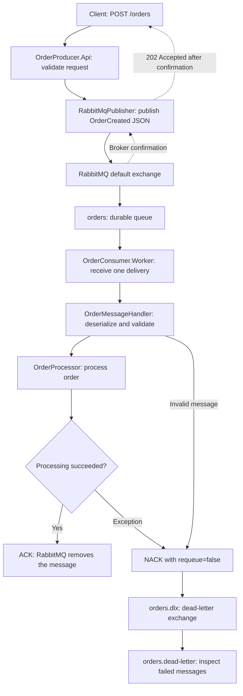

# How to Run Order Messaging System

This demo lets you send an order and watch it get processed.

## How the project works

The API receives an order and sends an `OrderCreated` event to RabbitMQ. A separate worker reads that event and processes the order. The API and worker run independently, so RabbitMQ can hold messages while the worker is offline.



### Order flow, step by step

1. **Send a request.** The client calls `POST /orders` with `customerName` and `totalAmount`.
2. **Validate the request.** The API requires a customer name of 1–100 characters after trimming and an amount greater than zero. Invalid requests return `400 Bad Request` without publishing an event.
3. **Create the event.** The API generates an `OrderId` and `CreatedAtUtc`, trims the customer name, and builds an `OrderCreated` event using the shared contract.
4. **Publish to RabbitMQ.** `RabbitMqPublisher` serializes the event as JSON and publishes a persistent message through the default exchange, using `orders` as the routing key. Both applications declare the same durable queues and dead-letter exchange.
5. **Return acceptance.** The API waits for RabbitMQ to confirm the publish before returning `202 Accepted` with the order ID and creation time. This confirms broker acceptance; processing may still be pending.
6. **Consume and process.** `Worker` uses manual acknowledgments and a prefetch count of one. `OrderMessageHandler` deserializes and validates the event, then calls `IOrderProcessor.ProcessAsync`. The current `OrderProcessor` logs the order and simulates work with a one-second delay.
7. **Acknowledge completion.** After processing completes, the handler sends an ACK. RabbitMQ removes the message, and the worker logs **Processed and acknowledged order**.

### What happens when something fails?

| Situation | Behavior |
| --- | --- |
| Publishing fails or times out | The API returns `503 Service Unavailable`. A timeout can leave the publish outcome unknown, so a client retry can create another order. |
| The worker is offline | Messages wait in `orders` until a consumer is available. |
| Invalid JSON, invalid event values, or a processing exception | The handler rejects the message without requeueing. RabbitMQ routes it through `orders.dlx` to `orders.dead-letter`. There is no automatic processing retry. |
| Connection loss, channel closure, consumer cancellation, or acknowledgment failure | The worker reconnects, waiting five seconds between attempts. Unacknowledged messages may be redelivered. |
| The worker shuts down during processing | It cancels unfinished work and closes the channel, leaving unacknowledged deliveries available for redelivery. |

Delivery can happen more than once, including when processing succeeds but the acknowledgment fails. When adding real business operations, make them safe to repeat for the same `OrderId`. The demo currently has no database or duplicate-processing protection.

Queue names above use the default `RabbitMq.QueueName` value, `orders`. Changing it also changes the dead-letter exchange to `<QueueName>.dlx` and the dead-letter queue to `<QueueName>.dead-letter`.

### Where the code lives

| Component | Responsibility |
| --- | --- |
| `OrderProducer.Api/Program.cs` | Receive HTTP requests, validate input, and return the publish result. |
| `OrderProducer.Api/Services/RabbitMqPublisher.cs` | Publish persistent JSON messages and wait for broker confirmation. |
| `Shared.Contracts/Events/OrderCreated.cs` | Define the event shared by producer and consumer. |
| `Shared.Contracts/Messaging/` | Share RabbitMQ configuration and queue/exchange declarations. |
| `OrderConsumer.Worker/Worker.cs` | Manage the consumer connection, deliveries, reconnection, and shutdown. |
| `OrderConsumer.Worker/OrderMessageHandler.cs` | Validate events and acknowledge or reject deliveries. |
| `OrderConsumer.Worker/OrderProcessor.cs` | Perform the order-processing operation; currently a simulated delay. |

## Run the project

Before starting, install **.NET 10 SDK**, **Docker with Docker Compose**, and **curl**. Make sure Docker is running.

Open a terminal in the `OrderMessagingSystem` folder. Use this folder in each new terminal below.

## 1. Build the project

Run each command and wait for it to finish:

```bash
dotnet restore OrderMessagingSystem.slnx
dotnet build OrderMessagingSystem.slnx --no-restore
```

You should see **Build succeeded**.

## 2. Start RabbitMQ

RabbitMQ holds orders until they are processed.

```bash
sudo docker compose up -d --wait
```

Enter your computer password if asked. Wait until it shows **Healthy**.

## 3. Start the order processor — terminal 1

In the same terminal, run:

```bash
dotnet run --project OrderConsumer.Worker
```

Wait for **Waiting for orders**. Leave this terminal running.

## 4. Start the API — terminal 2

The API receives the orders you send.

Open a **second terminal** in `OrderMessagingSystem` and run:

```bash
dotnet run --project OrderProducer.Api
```

Wait for **http://localhost:5000**. Leave this terminal running too.

## 5. Send an order — terminal 3

Open a **third terminal** and paste this whole command:

```bash
curl -i -X POST http://localhost:5000/orders \
  -H 'Content-Type: application/json' \
  -d '{"customerName":"Sopanha","totalAmount":50.00}'
```

You should receive **202 Accepted**. This means RabbitMQ confirmed the published order; processing may still be pending.

Check the **first terminal** for **Processed and acknowledged order**. Your project is working!

You can send another order by running the command again. Change `Sopanha` and `50.00` to try a different name and amount.

## 6. View the dashboard — optional

Open **http://localhost:15673** in your browser and sign in:

| Username | Password |
| --- | --- |
| `orderdev` | `orderdev_password` |

Select **Queues and Streams**, then **orders**. An empty queue is normal: the processor may have already finished the orders.

## 7. Stop when finished

Press **Ctrl+C** in the first and second terminals. Then run this in the third terminal:

```bash
sudo docker compose down
```

Your saved messages are kept.

To run the project again, start RabbitMQ with the command below, then repeat steps **3–5**:

```bash
sudo docker compose up -d --wait
```

## Need help?

If a step fails, copy the error shown in that terminal and include it when asking for help. Mention which step you were following.

## Run the tests

Run the API and consumer tests from `OrderMessagingSystem`:

```bash
dotnet test OrderMessagingSystem.slnx
```
