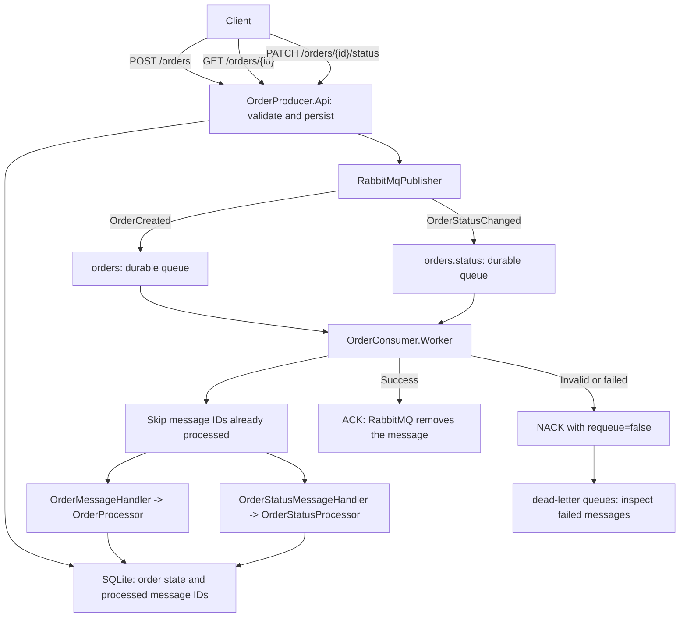

# Order Messaging System

## Project works

The API receives an order, stores it in a shared SQLite database, and sends an `OrderCreated` event to RabbitMQ. A separate worker reads that event, updates the order state, and records the message ID so redeliveries are not processed twice. The API and worker run independently, so RabbitMQ can hold messages while the worker is offline.



### Order flow

1. **Send a request.** The client calls `POST /orders` with `customerName`, `totalAmount`, and an optional `products` array. Each product contains `name`, `quantity`, and `unitPrice`.
2. **Validate the request.** The API requires a customer name of 1–100 characters after trimming and an amount greater than zero. If products are supplied, the array must be nonempty, names must contain 1–100 characters after trimming, quantities must be positive integers, and unit prices must be positive. The sum of `quantity * unitPrice` must equal `totalAmount`. Invalid requests return `400 Bad Request` without publishing an event.
3. **Create the event.** The API generates an `OrderId` and `CreatedAtUtc`, trims the customer name, and builds an `OrderCreated` event using the shared contract.
4. **Persist the order.** The API inserts the order with status `Received` before publishing. If RabbitMQ does not confirm the publish, the API removes the row it just inserted and returns `503 Service Unavailable`, so a failed request does not leave an order behind.
5. **Publish to RabbitMQ.** `RabbitMqPublisher` serializes the event as JSON and publishes a persistent message through the default exchange, using `orders` as the routing key. `OrderId` is the broker message ID. Both applications declare the same durable queues and dead-letter exchanges.
6. **Return acceptance.** The API waits for RabbitMQ to confirm the publish before returning `202 Accepted` with the order ID and creation time. This confirms broker acceptance; processing may still be pending.
7. **Check the order.** `GET /orders/{orderId}` returns the stored state: customer, total, products, status, status detail, and the time of the last status change. Unknown IDs return `404 Not Found`.
8. **Consume and deduplicate.** `Worker` uses manual acknowledgments and a prefetch count of one per queue. Before processing, each handler checks the broker message ID against the `ProcessedMessages` table. A message that was already fully processed is acknowledged and skipped, which makes redelivery after a lost ACK harmless.
9. **Process the order.** `OrderMessageHandler` deserializes and validates the event, then calls `IOrderProcessor.ProcessAsync`. `OrderProcessor` records `Processing`, logs the order and products, simulates work with a one-second delay, and records `Completed`. Status writes only apply when their timestamp is newer than the stored one.
10. **Acknowledge completion.** After processing completes, the handler records the message ID as processed and sends an ACK. RabbitMQ removes the message, and the worker logs **Processed and acknowledged order**.
11. **Update the status.** The client calls `PATCH /orders/{orderId}/status` with a `status` (`Received`, `Processing`, `Completed`, or `Failed`) and an optional `detail` of up to 500 characters. The API validates the request and returns `404 Not Found` if the order does not exist. It then publishes `OrderStatusChanged` to the `orders.status` queue and returns `202 Accepted` after broker confirmation. Invalid requests return `400 Bad Request` without publishing. The worker applies the update, so `GET /orders/{orderId}` may show the previous status for a moment.
12. **Consume status updates.** The same `Worker` consumes `orders.status` with its own prefetch and manual acknowledgments. It deduplicates by message ID, validates each update, then `OrderStatusProcessor` applies it to the shared database. Older or duplicate updates are ignored, so redelivery and out-of-order messages are safe. Failed or invalid status messages are rejected to `orders.status.dead-letter`.

## Requirement

 install **.NET 10 SDK**, **Docker with Docker Compose**, and **curl**. Make sure Docker is running.

Open a terminal in the `OrderMessagingSystem` folder. Use this folder in each new terminal below.

## 1.Run Build 

Run this command 

```bash
dotnet restore OrderMessagingSystem.slnx
dotnet build OrderMessagingSystem.slnx --no-restore
```

You should see **Build succeeded**.

## 2. Start RabbitMQ

RabbitMQ holds orders until they are processed.

```bash
sudo docker compose up -d --wait
```

Enter your computer password if asked. Wait until it shows **Healthy**.

## 3. Start the order processor — terminal 1

In the same terminal, run:

```bash
dotnet run --project OrderConsumer.Worker
```

Wait for **Waiting for orders in orders and status updates in orders.status**. Leave this terminal running.

## 4. Start the API — terminal 2

The API receives the orders you send.

Open a **second terminal** in `OrderMessagingSystem` and run:

```bash
dotnet run --project OrderProducer.Api
```

Wait for **http://localhost:5000**. Leave this terminal running too.

## 5. Send an order — terminal 3

Open a **third terminal** and paste this whole command:

```bash
curl -i -X POST http://localhost:5000/orders \
  -H 'Content-Type: application/json' \
  -d '{"customerName":"Sopanha","totalAmount":50.00,"products":[{"name":"Keyboard","quantity":2,"unitPrice":20.00},{"name":"Mouse","quantity":1,"unitPrice":10.00}]}'
```

You should receive **202 Accepted**. This means RabbitMQ confirmed the published order; processing may still be pending.

Check the **first terminal** for **Processed and acknowledged order**. Your project is working!

You can send another order by running the command again. Change the customer and products, keeping `totalAmount` equal to the sum of the product amounts. Product names are trimmed before publishing, and product details are included in the `OrderCreated` message and logged by the worker. Orders without `products` remain supported, including older queued messages.

### Query an order

Use the `orderId` from the `202 Accepted` response:

```bash
curl -i http://localhost:5000/orders/PASTE_ORDER_ID_HERE
```

The response contains the stored customer, total, products, status, status detail, and the time of the last status change. Right after creation the status is `Received`; it becomes `Processing` and then `Completed` as the worker runs. An unknown ID returns `404 Not Found`.

### Update an order status

Copy the `orderId` from the `202 Accepted` response and send a status update. The worker logs the new state and ignores older or duplicate updates:

```bash
curl -i -X PATCH http://localhost:5000/orders/PASTE_ORDER_ID_HERE/status \
  -H 'Content-Type: application/json' \
  -d '{"status":"Completed","detail":"Delivered to customer"}'
```

Accepted status values are `Received`, `Processing`, `Completed`, and `Failed`. `detail` is optional, trimmed, and limited to 500 characters. You should receive **202 Accepted**; check the worker terminal for **status updated to Completed**.

## 6. View the dashboard — optional

Open **http://localhost:15673** in your browser and sign in:

| Username | Password |
| --- | --- |
| `orderdev` | `orderdev_password` |

Select **Queues and Streams**. You should see `orders` and `orders.status` for live work, plus `orders.dead-letter` and `orders.status.dead-letter` for rejected messages. An empty queue is normal: the processor may have already finished the messages.

## 7. Stop when finished

Press **Ctrl+C** in the first and second terminals. Then run this in the third terminal:

```bash
sudo docker compose down
```

Your saved messages are kept.

### Where the data is stored

The API and the worker share a SQLite database at `~/.local/share/OrderMessagingSystem/orders.db`. The schema is created on startup. Set `Database__Path` in both terminals to use a different file (for example, `Database__Path=/tmp/orders.db`); relative paths are resolved under that shared folder. Delete the file to start with a clean database. The database holds order state and processed message IDs; RabbitMQ still holds queued messages.

To run the project again, start RabbitMQ with the command below, then repeat steps **3–5**:

```bash
sudo docker compose up -d --wait
```

## Run the tests

Run the API and consumer tests from `OrderMessagingSystem`:

```bash
dotnet test OrderMessagingSystem.slnx
```

The tests cover request validation, broker-confirmation behavior, persistence and stale-status guards, consumer deduplication by message ID, order processing, acknowledgement and dead-letter paths, status updates, and stale or duplicate status handling. They do not need a running RabbitMQ instance.
