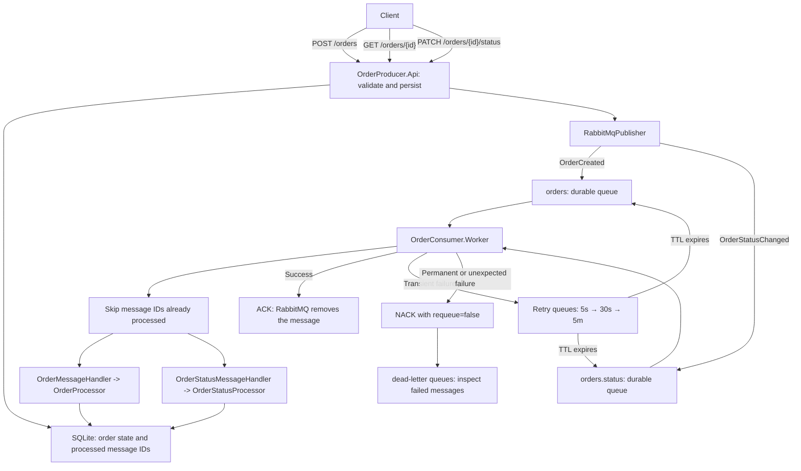
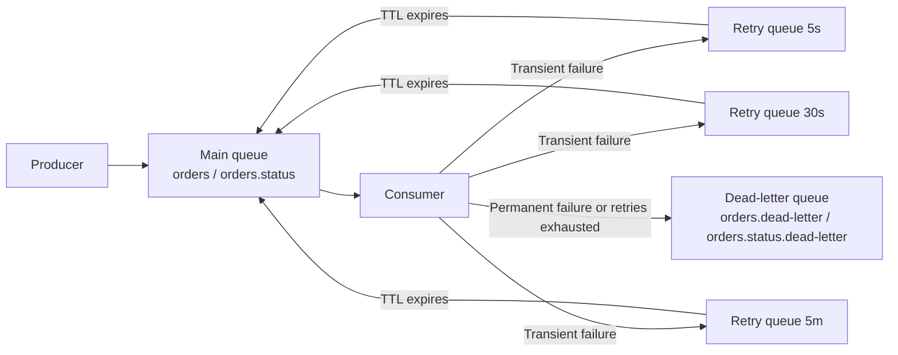

# Order Messaging System

## Project works

The API receives an order, stores it in a shared SQLite database, and sends an `OrderCreated` event to RabbitMQ. A separate worker reads that event, updates the order state, and records the message ID so redeliveries are not processed twice. The API and worker run independently, so RabbitMQ can hold messages while the worker is offline.



### Order flow

1. **Send a request.** The client calls `POST /orders` with `customerName`, `totalAmount`, and an optional `products` array. Each product contains `name`, `quantity`, and `unitPrice`.
2. **Validate the request.** The API requires a customer name of 1–100 characters after trimming and an amount greater than zero. If products are supplied, the array must be nonempty, names must contain 1–100 characters after trimming, quantities must be positive integers, and unit prices must be positive. The sum of `quantity * unitPrice` must equal `totalAmount`. Invalid requests return `400 Bad Request` without publishing an event.
3. **Create the event.** The API generates an `OrderId` and `CreatedAtUtc`, trims the customer name, and builds an `OrderCreated` event using the shared contract.
4. **Persist the order.** The API inserts the order with status `Received` before publishing. If RabbitMQ does not confirm the publish, the API removes the row it just inserted and returns `503 Service Unavailable`, so a failed request does not leave an order behind.
5. **Publish to RabbitMQ.** `RabbitMqPublisher` serializes the event as JSON and publishes a persistent message through the default exchange, using `orders` as the routing key. `OrderId` is the broker message ID. Both applications declare the same durable queues and dead-letter exchanges.
6. **Return acceptance.** The API waits for RabbitMQ to confirm the publish before returning `202 Accepted` with the order ID and creation time. This confirms broker acceptance; processing may still be pending.
7. **Check the order.** `GET /orders/{orderId}` returns the stored state: customer, total, products, status, status detail, and the time of the last status change. Unknown IDs return `404 Not Found`.
8. **Consume and deduplicate.** `Worker` uses manual acknowledgments and a prefetch count of one per queue. Before processing, each handler checks the broker message ID against the `ProcessedMessages` table. A message that was already fully processed is acknowledged and skipped, which makes redelivery after a lost ACK harmless.
9. **Process the order.** `OrderMessageHandler` deserializes and validates the event, then calls `IOrderProcessor.ProcessAsync`. `OrderProcessor` records `Processing`, logs the order and products, simulates work with a one-second delay, and records `Completed`. Status writes only apply when their timestamp is newer than the stored one.
10. **Acknowledge completion.** After processing completes, the handler records the message ID as processed and sends an ACK. RabbitMQ removes the message, and the worker logs **Processed and acknowledged order**. A transient infrastructure failure is published to a delayed retry queue instead; the original message is ACKed only after RabbitMQ confirms that retry publish.
11. **Update the status.** The client calls `PATCH /orders/{orderId}/status` with a `status` (`Received`, `Processing`, `Completed`, or `Failed`) and an optional `detail` of up to 500 characters. The API validates the request and returns `404 Not Found` if the order does not exist. It then publishes `OrderStatusChanged` to the `orders.status` queue and returns `202 Accepted` after broker confirmation. Invalid requests return `400 Bad Request` without publishing. The worker applies the update, so `GET /orders/{orderId}` may show the previous status for a moment.
12. **Consume status updates.** The same `Worker` consumes `orders.status` on its own channel with its own prefetch and manual acknowledgments. It deduplicates by message ID, validates each update, then `OrderStatusProcessor` applies it to the shared database. Older or duplicate updates are ignored, so redelivery and out-of-order messages are safe. Transient status failures use `orders.status.retry.*`; invalid or permanently failed status messages are rejected to `orders.status.dead-letter`.

## Reliability: retry before the dead-letter queue

Without retries, a short-lived failure such as a locked SQLite file or a brief timeout sends a perfectly valid message straight to the DLQ. The order is then stuck until an operator replays it. The worker therefore retries **transient** failures on a bounded schedule and keeps the **DLQ for permanent failures and exhausted retries**.

### Failure classification

| Classification | Examples | Action |
| --- | --- | --- |
| Permanent | Invalid JSON, missing/invalid schema, business validation failure | NACK with `requeue=false`; RabbitMQ dead-letters to the DLQ |
| Transient | `IOException`, `TimeoutException`, SQLite `SQLITE_BUSY` (5), SQLite `SQLITE_LOCKED` (6), including these errors wrapped in EF Core exceptions | Publish to the next retry queue, wait for broker confirmation, then ACK the original delivery |
| Unexpected | Any other exception, including non-recoverable SQLite errors | Logged at error level and dead-lettered to the DLQ (a documented bounded policy, not an infinite retry loop) |

Not every `SqliteException` is retried. Only error codes 5 and 6 are treated as recoverable; for example, `SQLITE_CONSTRAINT` (19) is permanent.

### Retry topology



Each main queue has three durable retry queues. A retry queue has `x-message-ttl` set to its delay and `x-dead-letter-exchange` pointing at the existing `<queue>.dlx` exchange. Expired messages are routed back to the original main queue with the `<queue>.retry.return` routing key; permanent failures from the main queue use the existing `<queue>` routing key to reach the DLQ.

| Attempt | Order queue | Status queue | Delay |
| --- | --- | --- | --- |
| 1 | `orders.retry.5s` | `orders.status.retry.5s` | 5 seconds |
| 2 | `orders.retry.30s` | `orders.status.retry.30s` | 30 seconds |
| 3 | `orders.retry.5m` | `orders.status.retry.5m` | 5 minutes |
| Exhausted | `orders.dead-letter` | `orders.status.dead-letter` | No further retry |

### Attempt tracking and safety

- The handler reads RabbitMQ's `x-death` header and considers only entries where `reason=expired` and `queue` is one of the retry queues. It advances to the stage after the furthest completed retry queue, so duplicate copies cannot skip ahead. Rejections from the main queue (`reason=rejected`) and unrelated dead-letter events do not advance the schedule.
- The retry publisher also writes `x-retry-attempt` (`1`, `2`, or `3`) as an independent guard. If `x-death` were lost or stripped, this header still stops the loop at the DLQ.
- Retry messages preserve the original payload, `MessageId`, `CorrelationId`, message type, and headers. The original `MessageId` is kept, so deduplication and idempotent status writes continue to work.
- A failed message is never recorded in `ProcessedMessages`. On redelivery, the work is retried; order creation is guarded by the order ID, and status updates are timestamp-guarded.
- For a transient failure, the worker publishes to the retry queue on a **publisher-confirm** channel and ACKs the original delivery only after the broker confirms the retry publish. If the publish is not confirmed, the handler leaves the original delivery unsettled; the worker reconnects and RabbitMQ requeues it. An ambiguous confirmation can produce a duplicate retry copy, which is safe because processing is deduplicated and idempotent.
- NACK with `requeue=false` uses the main queue's configured dead-letter exchange. The worker never assumes that a NACK can target an arbitrary queue.
- Order and status consumers each have their own channel, and the retry publisher has a separate confirm-enabled channel. A semaphore serializes publishes on that channel, so no channel is shared by concurrent operations.

### Test retries locally

1. Start RabbitMQ, the API, and the worker as described below. Create an order so you have an order ID to update.
2. Hold a write lock on the shared database for longer than the five-second SQLite busy timeout. In a separate terminal:

   ```bash
   sqlite3 ~/.local/share/OrderMessagingSystem/orders.db
   BEGIN EXCLUSIVE;
   ```

3. While the lock is held, send a status update with the API. The API can still read under WAL and publish, but the worker's status write hits SQLite busy. The worker logs a transient failure and publishes to `orders.status.retry.5s`; the original status message is ACKed only after that publish is confirmed.
4. Release the lock with `COMMIT;` and exit. When the five-second TTL expires, the message returns to `orders.status` and the retry succeeds.

   > `sqlite3` must be installed for this manual test. You can also rely on the classification and handler tests, which simulate the same failures without a broker:

   ```bash
   dotnet test OrderMessagingSystem.slnx --filter "FullyQualifiedName~OrderConsumerTests|FullyQualifiedName~RetryHeaderInspectorTests"
   ```

### Inspect retry queues

Open **http://localhost:15673** and select **Queues and Streams**. You should see the main queues, the three retry queues per stream, and the DLQs:

- `orders` and `orders.status` — live work.
- `orders.retry.5s`, `orders.retry.30s`, `orders.retry.5m` — delayed order retries.
- `orders.status.retry.5s`, `orders.status.retry.30s`, `orders.status.retry.5m` — delayed status retries.
- `orders.dead-letter` and `orders.status.dead-letter` — permanent failures or exhausted retries.

Retry queues have no consumers: their Ready count drops when a message's TTL expires. Open a message to inspect its `x-death` entries and `x-retry-attempt` header. Retry queues normally drain themselves; the DLQs keep messages until you inspect or replay them. Use the management UI's **Get messages** action carefully and requeue messages you do not intend to consume.

The optional integration tests verify the retry queue TTLs through the management API and measure the first retry against a real broker:

```bash
RABBITMQ_INTEGRATION_TESTS=1 dotnet test OrderMessagingSystem.slnx \
  --filter "FullyQualifiedName~RabbitMqIntegrationTests"
```

They require the Docker RabbitMQ instance and are reported as skipped when `RABBITMQ_INTEGRATION_TESTS` is not set. The 30-second and 5-minute delays are verified by the schedule/topology tests rather than by waiting in the test suite.

## Requirement

 install **.NET 10 SDK**, **Docker with Docker Compose**, and **curl**. Make sure Docker is running.

Open a terminal in the `OrderMessagingSystem` folder. Use this folder in each new terminal below.

## 1.Run Build 

Run this command 

```bash
dotnet restore OrderMessagingSystem.slnx
dotnet build OrderMessagingSystem.slnx --no-restore
```

You should see **Build succeeded**.

## 2. Start RabbitMQ

RabbitMQ holds orders until they are processed.

```bash
sudo docker compose up -d --wait
```

Enter your computer password if asked. Wait until it shows **Healthy**.

## 3. Start the order processor — terminal 1

In the same terminal, run:

```bash
dotnet run --project OrderConsumer.Worker
```

Wait for **Waiting for orders in orders and status updates in orders.status**. Leave this terminal running.

## 4. Start the API — terminal 2

The API receives the orders you send.

Open a **second terminal** in `OrderMessagingSystem` and run:

```bash
dotnet run --project OrderProducer.Api
```

Wait for **http://localhost:5000**. Leave this terminal running too.

## 5. Send an order — terminal 3

Open a **third terminal** and paste this whole command:

```bash
curl -i -X POST http://localhost:5000/orders \
  -H 'Content-Type: application/json' \
  -d '{"customerName":"Sopanha","totalAmount":50.00,"products":[{"name":"Keyboard","quantity":2,"unitPrice":20.00},{"name":"Mouse","quantity":1,"unitPrice":10.00}]}'
```

You should receive **202 Accepted**. This means RabbitMQ confirmed the published order; processing may still be pending.

Check the **first terminal** for **Processed and acknowledged order**. Your project is working!

You can send another order by running the command again. Change the customer and products, keeping `totalAmount` equal to the sum of the product amounts. Product names are trimmed before publishing, and product details are included in the `OrderCreated` message and logged by the worker. Orders without `products` remain supported, including older queued messages.

### Query an order

Use the `orderId` from the `202 Accepted` response:

```bash
curl -i http://localhost:5000/orders/PASTE_ORDER_ID_HERE
```

The response contains the stored customer, total, products, status, status detail, and the time of the last status change. Right after creation the status is `Received`; it becomes `Processing` and then `Completed` as the worker runs. An unknown ID returns `404 Not Found`.

### Update an order status

Copy the `orderId` from the `202 Accepted` response and send a status update. The worker logs the new state and ignores older or duplicate updates:

```bash
curl -i -X PATCH http://localhost:5000/orders/PASTE_ORDER_ID_HERE/status \
  -H 'Content-Type: application/json' \
  -d '{"status":"Completed","detail":"Delivered to customer"}'
```

Accepted status values are `Received`, `Processing`, `Completed`, and `Failed`. `detail` is optional, trimmed, and limited to 500 characters. You should receive **202 Accepted**; check the worker terminal for **status updated to Completed**.

## 6. View the dashboard — optional

Open **http://localhost:15673** in your browser and sign in:

| Username | Password |
| --- | --- |
| `orderdev` | `orderdev_password` |

Select **Queues and Streams**. You should see `orders` and `orders.status` for live work, the `.retry.5s`, `.retry.30s`, and `.retry.5m` queues for delayed retries, plus `orders.dead-letter` and `orders.status.dead-letter` for rejected messages. An empty queue is normal: the processor may have already finished the messages, and retry queues drain themselves when their TTL expires.

## 7. Stop when finished

Press **Ctrl+C** in the first and second terminals. Then run this in the third terminal:

```bash
sudo docker compose down
```

Your saved messages are kept.

### Where the data is stored

The API and the worker share a SQLite database at `~/.local/share/OrderMessagingSystem/orders.db`. The schema is created on startup. Set `Database__Path` in both terminals to use a different file (for example, `Database__Path=/tmp/orders.db`); relative paths are resolved under that shared folder. Delete the file to start with a clean database. The database holds order state and processed message IDs; RabbitMQ still holds queued messages.

To run the project again, start RabbitMQ with the command below, then repeat steps **3–5**:

```bash
sudo docker compose up -d --wait
```

## Run the tests

Run the API and consumer tests from `OrderMessagingSystem`:

```bash
dotnet test OrderMessagingSystem.slnx
```

The unit tests cover request validation, broker-confirmation behavior, persistence and stale-status guards, consumer deduplication by message ID, order processing, acknowledgement and dead-letter paths, transient/permanent failure classification, retry-stage selection from `x-death`, retry-queue topology, message identity preservation, status updates, and stale or duplicate status handling. They do not need a running RabbitMQ instance.

Three opt-in integration tests run against the Docker RabbitMQ instance when `RABBITMQ_INTEGRATION_TESTS=1` is set. They verify the declared retry TTLs, the real first-retry timing, and that a republished retry keeps its `x-death` metadata; without the environment variable they are reported as skipped.
